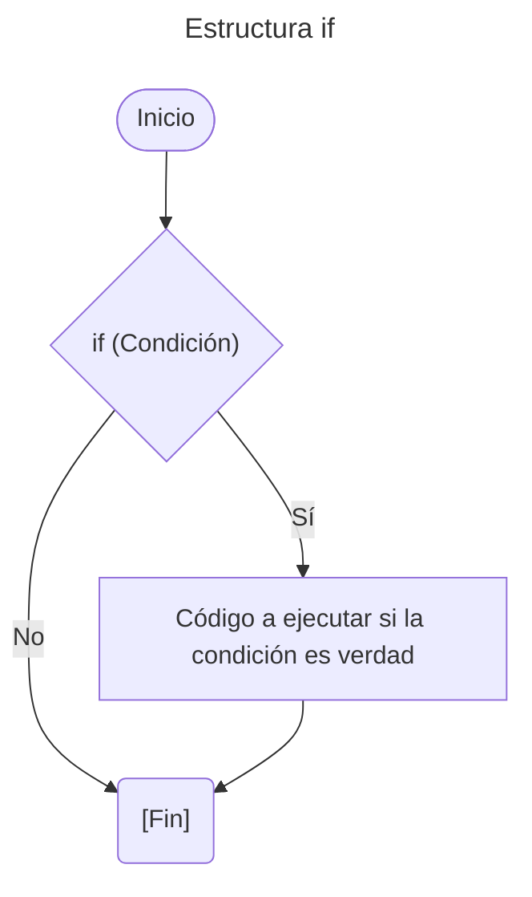
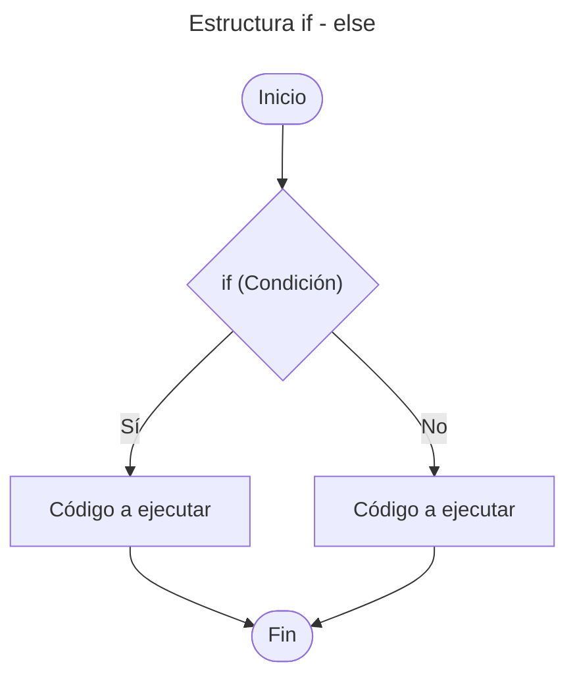
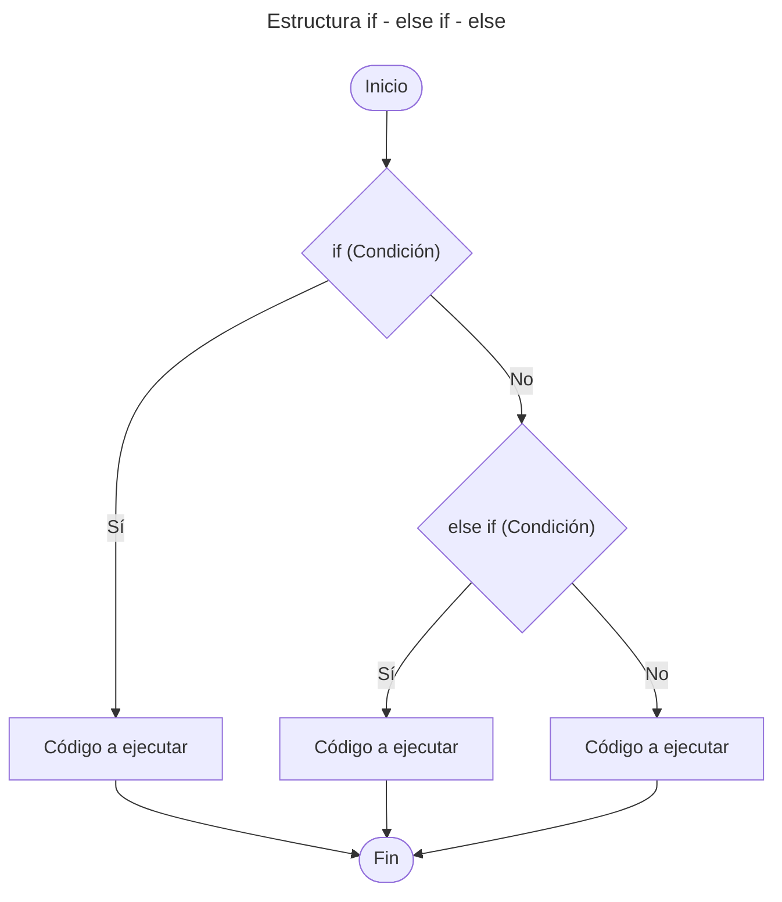
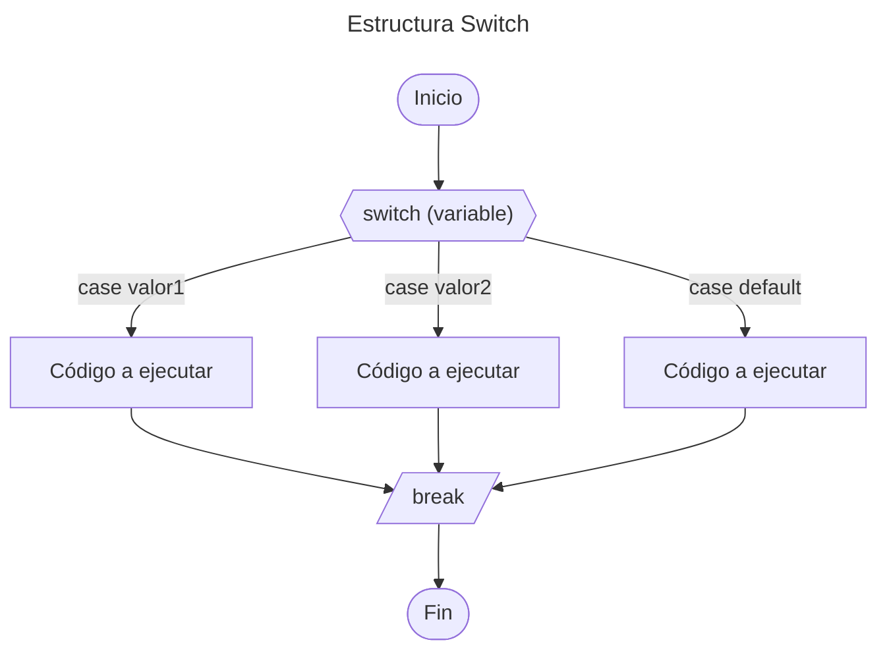
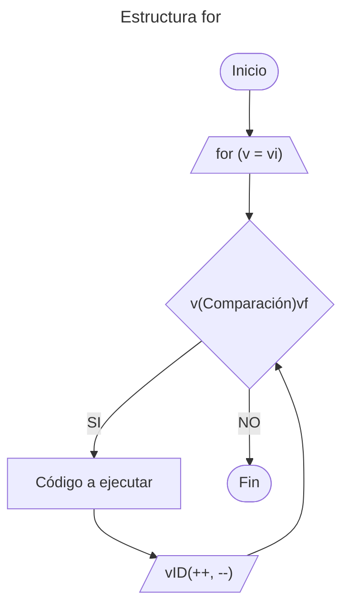
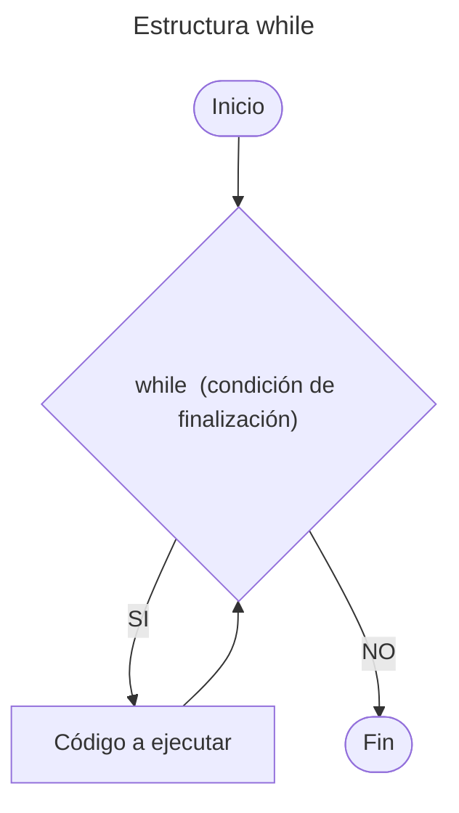
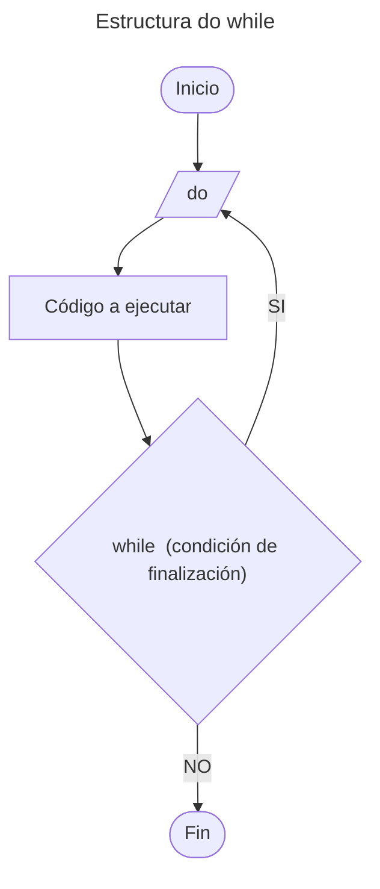

# 5. Estructuras de Control

Nos permite controlar el flujo de ejecución de un programa.

---

## Tabla de Contenido

- [5. Estructuras de Control](#5-estructuras-de-control)
  - [Tabla de Contenido](#tabla-de-contenido)
  - [Estructuras Condicionales](#estructuras-condicionales)
    - [Estructura `if`](#estructura-if)
    - [Estructura `if-else`](#estructura-if-else)
    - [Estructura `if-else if-else`](#estructura-if-else-if-else)
    - [Estructura `Switch`](#estructura-switch)
    - [Operador Condicional](#operador-condicional)
  - [Estructura Bucle / loop](#estructura-bucle--loop)
    - [Estructura `for`](#estructura-for)
    - [Estructura `while`](#estructura-while)
    - [Estructura `do while`](#estructura-do-while)
    - [Control de Bucle](#control-de-bucle)
      - [Control `break`](#control-break)
      - [Control `continue`](#control-continue)
  - [Ejemplo Practico](#ejemplo-practico)

---

## Estructuras Condicionales

Permite ejecutar diferentes bloques de código según se  cumpla o no una determinada condición.

### Estructura `if`

Su función es realizar o no una determinada acción o sentencia, basándose en el resultado de la evaluación de una expresión booleana **(verdadero o falso)**.

***Sintaxis***

```cpp
if (Condición){
    # Bloque de código a ejecutar si la condición es verdad
}
```

**Diagrama de flujo:**



### Estructura `if-else`

La estructura selectiva doble ``if - else`` permite toma de decisión. Si la condición es **verdadera**, entonces se sigue por un camino específico y se ejecuta una acción determinada. Por otra parte, si el resultado de la evaluación es **falso**, entonces se sigue por otro camino y se realiza otra acción. En ambos casos, luego de ejecutar las acciones correspondientes, se continúa con la secuencia normal del diagrama de flujo.

***Sintaxis***

```cpp
if (Condición){
    // Bloque de código a ejecutar si la condición es verdad
}
else{
    // Bloque de código a ejecutar si la condición es falsa
    }
```

**Diagrama de flujo:**



### Estructura `if-else if-else`

Permite establecer una serie de condiciones al interior del programa, que ayuda a determinar qué acciones llevar a cabo dadas ciertas circunstancias. La sentencia ``else if`` se usa cuando deseamos evaluar múltiples condiciones.

***Sintaxis***

```cpp
if (Condición){
    // Bloque de código a ejecutar si la condición es verdad
}
elif (Condición){
    // Bloque de código a ejecutar si if es falso y la condición es verdad
}
else{
    // Bloque de código a ejecutar si todas las condiciones son falsa
}
```

**Diagrama de flujo:**



### Estructura `Switch`

Los condicionales Switch, son una estructura de control condicional, que permite definir múltiples casos que puede llegar a cumplir una variable, y qué acción tomar en cualquiera de estas situaciones, incluso es posible determinar qué acción llevar a cabo en caso de no cumplir ninguna de las condiciones dadas.

```cpp
switch (variable) {
    case valor1:
        // Código a ejecutar si variable es igual a value1
        break;
    case valor2:
        // Código a ejecutar si variable es igual a value2
        break;
    default:
        // Código a ejecutar si ningún caso coincide
}
```

*Componentes clave:*

- `case`: representa un posible valor de la variable
- `break`: sale de `switch` después de ejecutar un `case` (evita la ejecución sucesiva)
- `default`: `case` opcional que se ejecuta si ningún otro `case` coincide

**Diagrama de flujo:**



> [!NOTE]
> Es posible combinar varios case dejando los  casos comunes en blanco.
>
> **Ejemplo**

```cpp
switch (day) {
    case 1:
    case 2:
    case 3:
        dayName = "Start of week";
        break;
    default:
        dayName = "Invalid day";
}
```

### Operador Condicional

El operador condicional es una declaración `if-else` de una sola línea. Puede reemplazar una instrucción `if-else` simple que asigna un valor a una variable.

***Sintaxis:***

```cpp
variable = (condición) ? valor_if_true : valor_if_false;
```

**Ejemplo:**

```cpp
int age = 20;
std::string message = (age >= 18) ? "Adult" : "Minor";
```

Es posible aplicar multiples condiciones

***Sintaxis:***

```cpp
variable = (condición1) ? valor1 : (condición2) ? valor2 : valor3;
```

---

## Estructura Bucle / loop

Los bucles permiten repetir un bloque de código n veces

### Estructura `for`

El bucle for permite repetir el código varias veces.

***Sintaxis:***

```cpp
for ("v = vi"; v("Comparación")vf; vID"Actualización") {
    // Código a ejecutar
}
```

*Componentes clave:*

- `v` = Variable de control
- `vi` = Valor inicial
- `vf` = Valor final
- `vID` = Actualización de variable de control puede incrementar o decremento de acuerdo con el ID

**Diagrama de flujo:**



### Estructura `while`

Permite repetir un conjunto de interacciones. Sin embargo, **el número de veces** que se debe repetir **depende de la condición de finalización**. Cada vez que **inicia el ciclo se evalúa una condición**, si ésta es *verdadera* se continúa con la ejecución, de otra forma se detiene.

> [WARNING!]
> **Dentro** del ciclo **siempre debe existir un enunciado que afecte la condición**, de tal forma que aquél no se repita de manera infinita.

***Sintaxis***

```cpp
while (condición de finalización) { 
    Código a ejecutar
}
```

> [NOTE!]
> Si el cuerpo del bucle contiene solo una instrucción, las llaves son opcionales.

 ***Sintaxis***

 ```cpp
 while (condición de finalización) Código a ejecutar;
 ```

**Diagrama de flujo:**



### Estructura `do while`

A diferencia de las estructuras `for` y `while`, en las cuales las condiciones se evalúan al *principio del ciclo*, en ésta se **evalúan al final**. Esto implica que **el ciclo se debe ejecutar por lo menos una vez**. La estructura es adecuada cuando no sabemos el número de veces que se debe repetir un ciclo, pero conocemos que se debe ejecutar por lo menos una vez.

 ***Sintaxis***

 ```cpp
 do {
    // Código a ejecutar
} while (condición de finalización);
 ```

**Diagrama de flujo:**



### Control de Bucle

Existen algunas instrucciones especiales para controlar el flujo de ejecución dentro de los bucles.

#### Control `break`

Se utiliza para salir prematuramente de un bucle, independientemente de la condición. Cuando se encuentra un `break`, el **bucle se detiene** y el flujo de ejecución continúa con la siguiente instrucción fuera del bucle.

**Ejemplo:**

```cpp
for (int i = 0; i < 10; i++) {
    if (i == 6) {
        break;
    }
    std::cout << i << std::endl;
}
```

El bucle itera regularmente hasta que llega al número 6. Luego, el programa entra en la sentencia `if` y ejecuta la sentencia `break`. Esto sale del bucle inmediatamente.

#### Control `continue`

La instrucción `continue` detiene la iteración actual y continúa con la siguiente iteración

**Ejemplo:**

```cpp
for (int i = 3; i < 9; i++) {
    if (i == 5) {
        continue;
    }
    std::cout << i << std::endl;
}
```

Esto omitirá la iteración cuando `i=5`

---

## Ejemplo Practico

1. *Estructuras Condicionales*
   1. [Estructura `if`](/01_Fundamentos/05_Estructuras_de_Control/02_Estructura_if.cpp)
   2. [Estructura `if - else if - else`](/01_Fundamentos/05_Estructuras_de_Control/03_Estructura_if_elseif-else.cpp)
   3. [Estructura `switch`](/01_Fundamentos/05_Estructuras_de_Control/04_Estructura_Switch.cpp)
   4. [Operador Condicional](/01_Fundamentos/05_Estructuras_de_Control/05_Operador_Condicional.cpp)
2. *Estructuras Bucle / loop*
   1. [Estructura `for`](/01_Fundamentos/05_Estructuras_de_Control/06_Estructura_for.cpp)
   2. [Estructura `while`](/01_Fundamentos/05_Estructuras_de_Control/07_Estructura_while.cpp)
   3. [Estructura `do while`](/01_Fundamentos/05_Estructuras_de_Control/08_Estructura_do_while.cpp)
   4. *Control de Bucle*
      1. [Control `break`](/01_Fundamentos/05_Estructuras_de_Control/09_Control_break.cpp)
      2. [Control `continue`](/01_Fundamentos/05_Estructuras_de_Control/10_Control_continue.cpp)

---

[Inicio](#5-estructuras-de-control)

---

[Tabla de contenido principal](/Tabla_Contenido.md)

---
